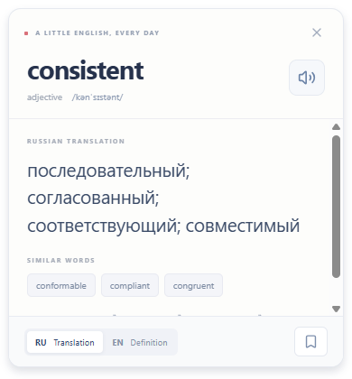
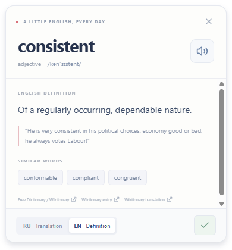
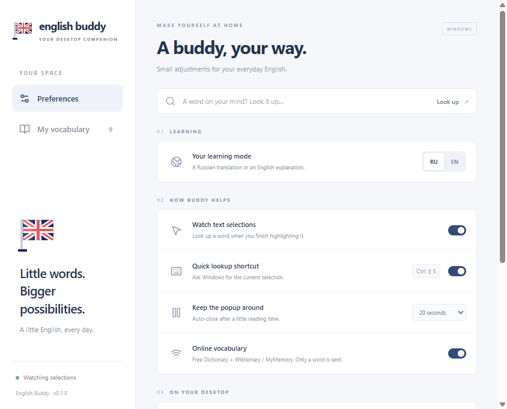
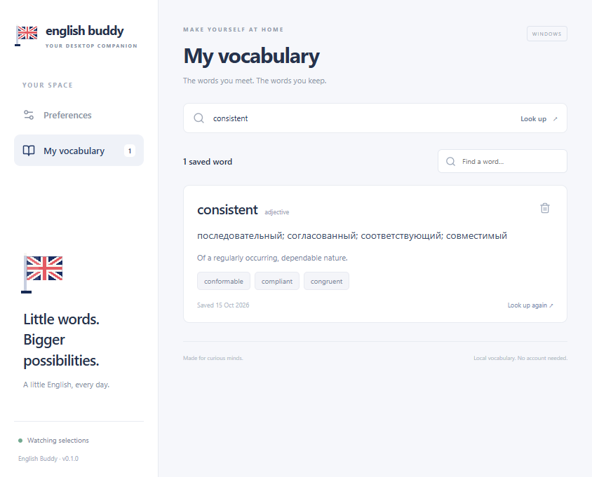
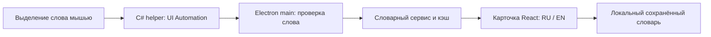

# English Buddy

**Плавающий помощник для изучения английского в Windows.** Выделите английское слово в другом приложении — рядом с небольшим британским флагом появится русский перевод или английское определение. Сохраняйте новые слова в локальный словарь и возвращайтесь к ним позже.

[Скачать приложение](https://github.com/selecteg12/english-buddy/releases/latest) · [English documentation](README.en.md) · [Отчёт о проверке](VERIFICATION.md) · [Лицензия](LICENSE)

**Платформа:** Windows 10/11, x64. **Версия:** MVP 0.1.0. **Язык интерфейса:** английский. Регистрация и платная подписка не нужны.

## Скачать и запустить

Готовые сборки находятся в [GitHub Releases](https://github.com/selecteg12/english-buddy/releases/tag/v0.1.0):

- **[English-Buddy-Portable-0.1.0-x64.exe](https://github.com/selecteg12/english-buddy/releases/download/v0.1.0/English-Buddy-Portable-0.1.0-x64.exe)** — запуск без установки.
- **[English-Buddy-Setup-0.1.0-x64.exe](https://github.com/selecteg12/english-buddy/releases/download/v0.1.0/English-Buddy-Setup-0.1.0-x64.exe)** — установщик с выбором папки и ярлыками.
- **[SHA256SUMS.txt](https://github.com/selecteg12/english-buddy/releases/download/v0.1.0/SHA256SUMS.txt)** — контрольные суммы файлов.

Для готового `.exe` не нужны Node.js, npm, сервер разработки или отдельный .NET SDK. Нативный помощник использует .NET Framework 4.x; в обычных установках Windows 10/11 есть .NET Framework 4.8.

1. Скачайте portable-файл или установщик.
2. Запустите English Buddy. При первом запуске откроется окно настроек.
3. Нажмите **Start learning**. На рабочем столе останется небольшой флаг.
4. Выделите одно английское слово мышью или двойным щелчком, например `consistent`.
5. Выберите **RU Translation** или **EN Definition**. Нажмите закладку, чтобы сохранить слово.

Сборки MVP не имеют цифровой подписи, поэтому Windows SmartScreen может показать предупреждение. Проверяйте источник загрузки и контрольную сумму. Приложение не отключает защиту Windows и не меняет настройки безопасности.

Проверить скачанный файл в PowerShell:

```powershell
Get-FileHash -LiteralPath '.\English-Buddy-Portable-0.1.0-x64.exe' -Algorithm SHA256
```

Сравните результат с соответствующей строкой `SHA256SUMS.txt`.

## Скриншоты

Это изображения работающего приложения. Значения слов получены от настоящих словарных сервисов; демонстрационные данные в production не используются.

### Русский перевод



### Английское определение



### Настройки



### Сохранённые слова



## Возможности

- Оригинальный SVG-флаг с плавной анимацией и прозрачным фоном.
- Флаг и карточка поверх обычных окон, без отдельного значка помощника в панели задач.
- Перетаскивание флага, сохранение позиции и ограничение перемещения рабочей областью монитора.
- Автоматическое чтение выделенного слова через Windows UI Automation.
- Запасная глобальная клавиша **Ctrl+Shift+E** и явное чтение скопированного слова через **Use copied word**.
- Русский перевод, английское определение, часть речи, IPA, синонимы и пример, когда они есть у источника.
- Произношение системным голосом Windows.
- Переключение RU/EN без повторной загрузки полученных значений.
- Локальный словарь: сохранение без дубликатов, поиск, удаление, восстановление после перезапуска.
- Кэш, таймауты, ограниченные повторные попытки и ограничения частоты запросов.
- Меню в трее: пауза, скрытие, показ, настройки, словарь и выход.

## Управление

- **Перетащить флаг:** переместить помощника.
- **Щёлкнуть по флагу:** открыть Preferences.
- **Правый щелчок по флагу:** открыть меню.
- **Значок в трее:** настройки, словарь, пауза, скрытие или выход.
- **Ctrl+Shift+E:** прочитать текущее выделение через Windows UI Automation.
- **Закладка:** сохранить слово.
- **Крестик в карточке:** закрыть карточку; приложение продолжит работать.
- **Quit English Buddy:** полностью закрыть приложение и нативный помощник.

Карточка появляется без запроса клавиатурного фокуса. Окно настроек получает фокус, когда пользователь явно открывает его.

### Если автоматическое чтение не сработало

1. Попробуйте **Ctrl+Shift+E** после выделения слова.
2. Если приложение не отдаёт выделение, самостоятельно скопируйте одно слово через **Ctrl+C**.
3. Нажмите **Use copied word** в карточке, Preferences или меню флага.

Есть ручной ввод: поле **A word on your mind? Look it up…** в Preferences.

English Buddy **не нажимает Ctrl+C автоматически, не заменяет содержимое буфера обмена и не читает его в фоновом режиме**. Буфер читается только по команде Use copied word.

## Совместимость и ограничения

Проверено:

- **Yandex Browser 26.8 / Chromium 150:** выделение двойным щелчком на локальной HTML-странице, стандартные настройки доступности, отдельный чистый профиль.
- **Windows RichTextBox:** настоящее выделение мышью и получение выделения горячей клавишей.
- **Поле пароля Windows:** выделение проигнорировано.

**ChatGPT для Windows пока требует ручной проверки.** Microsoft Word, Chrome, Edge, Firefox и внешние PDF-программы отдельно не проверялись. Успешная проверка страницы в Яндекс Браузере не означает совместимость с любым сайтом, PDF или нестандартным редактором.

Приложение получает текст через интерфейс доступности Windows. Оно не анализирует скриншоты и не использует OCR, поэтому не может универсально читать любое визуальное выделение. Изображения, сканированные PDF, некоторые нестандартные элементы интерфейса и окна с более высокими привилегиями могут быть недоступны.

Автоматический триггер — выделение мышью; для выделения только с клавиатуры используйте горячую клавишу. Проверка физических мониторов с разными DPI и эксклюзивных полноэкранных приложений остаётся ручной. Расчёты положения окон покрыты модульными тестами.

Статус: [VERIFICATION.md](VERIFICATION.md). Сохранены [результаты desktop-теста](docs/verification/desktop-test.txt), [проверки Яндекс Браузера](docs/verification/yandex-test.txt) и [запуска упакованной версии](docs/verification/packaged-test.txt).

## Настройки

В **Preferences** доступны:

- **Your learning mode:** русский перевод или английское определение.
- **Watch text selections:** включить или приостановить автоматическое чтение.
- **Quick lookup shortcut:** включить или отключить Ctrl+Shift+E.
- **Keep the popup around:** закрывать карточку через 10, 20, 30, 60, 120 секунд или только вручную.
- **Online vocabulary:** разрешить обращения к словарным сервисам.
- **A little flag animation:** включить или отключить анимацию флага.
- **Start with Windows:** запуск при входе в Windows; доступен в упакованной сборке.
- **Reset position:** вернуть флаг к углу основного монитора.
- **Clear cache:** очистить результаты запросов, сохранив My vocabulary.
- **Hide Buddy:** скрыть помощника и приостановить автоматическое чтение. Показать его можно через трей.

Автозапуск по умолчанию выключен. Чтение выделения начинается после Start learning.

## Приватность и локальные данные

Нет аккаунта, телеметрии, синхронизации словаря с облаком или фоновой передачи текста документа.

Перед отправкой слово проверяется: до 64 символов, английские латинские буквы, допустимы внутренние апострофы и дефисы. Пробелы по краям убираются, регистр нормализуется. Фразы, числа, адреса электронной почты и неанглийские выделения отклоняются. Поля, которые UI Automation определяет как парольные, пропускаются.

Онлайн-сервисы получают **одно проверенное слово** и обычные сетевые сведения, включая IP-адрес. В обычной работе выделенный текст не записывается в журнал.

Данные по умолчанию хранятся в `%APPDATA%\english-buddy`:

- `buddy.json` — настройки, положение и сохранённые слова.
- `cache.json` — кэш запросов.

Это локальные JSON-файлы без шифрования. Повреждённый файл настроек сохраняется с суффиксом `.damaged-…`, а приложение сообщает о восстановлении значений по умолчанию.

Можно выбрать другую папку, например для portable-режима:

```powershell
& '.\English-Buddy-Portable-0.1.0-x64.exe' '--buddy-data=C:\EnglishBuddyData'
```

Сохранённый словарь доступен без сети. При выключенном Online vocabulary можно получать полные ранее кэшированные значения; для нового слова требуется интернет. Кэш хранит до 500 слов с обычным сроком 7 дней. Очистка кэша не удаляет сохранённую лексику.

## Словарные источники и лицензии

- **[Free Dictionary API](https://dictionaryapi.dev/)** — английские определения, части речи, IPA, примеры и синонимы. В карточке указаны источник и его лицензия, часто [CC BY-SA 3.0](https://creativecommons.org/licenses/by-sa/3.0/).
- **[Wiktionary](https://en.wiktionary.org/)** — основной источник русских переводов и дополнительный источник синонимов из английского раздела статьи. Используется [MediaWiki API](https://www.mediawiki.org/wiki/API:Revisions). Текущий текст — [CC BY-SA 4.0](https://en.wiktionary.org/wiki/Wiktionary:Copyrights); ссылка на статью и лицензию есть в карточке.
- **[MyMemory](https://mymemory.translated.net/)** — запасной переводчик. Действуют [условия](https://mymemory.translated.net/doc/en/tos.php), [спецификация API](https://mymemory.translated.net/doc/spec.php) и [лимиты](https://mymemory.translated.net/doc/usagelimits.php).

Платные ключи и вымышленные данные не используются. Качество зависит от источников: слово может иметь несколько значений, а переводы и синонимы могут относиться к разным значениям. Карточка показывает одно английское определение. Это словарный текст, без упрощения нейросетью. Отсутствующие поля и временные ошибки обозначаются явно.

При форматировании русских переводов убираются знаки ударения, отдельные варианты соединяются точкой с запятой. Словарный текст и текст на скриншотах сохраняют лицензии источников; MIT-лицензия кода их не заменяет. Флаг и иконка нарисованы локально из геометрических фигур.

## Разработка из исходников

Нужны **Windows x64**, **Node.js 24+**, npm и C#-компилятор .NET Framework 4.x по стандартному пути Windows. Отдельный .NET SDK не нужен.

```powershell
git clone https://github.com/selecteg12/english-buddy.git
cd english-buddy
npm ci
node node_modules/electron/install.js
npm run dev
```

Установку бинарного Electron выполняйте явно: современный npm-пакет Electron устанавливается отдельно от исполняемой среды. Зависимости находятся в devDependencies, потому что React и словарные библиотеки включаются в production-бандлы; готовое приложение не требует npm-модулей пользователя.

`npm run dev` компилирует помощник, запускает Vite на `127.0.0.1:5173` и Electron. Renderer обновляется через Vite. Main/preload пересобираются, но для применения изменений перезапустите dev-команду. После изменения C# тоже перезапустите её.

### Команды

```powershell
npm run typecheck       # Строгая проверка TypeScript
npm run lint            # ESLint
npm test                # Модульные тесты Vitest
npm run check           # Все три проверки выше
npm run native          # C#-помощник и иконки
npm run build           # Полная production-сборка
npm start               # Запуск production-сборки из проекта
npm run package:dir     # Упакованное приложение без установщика
npm run package         # NSIS-установщик и portable .exe
```

После упаковки файлы находятся в `release/`. Production-приложение загружает локальные файлы через `buddy://app`; Vite ему не нужен.

### Интеграционные проверки

```powershell
npm run build
npm run test:desktop
node scripts/live-check.mjs
node scripts/yandex-test.mjs

# После npm run package или npm run package:dir:
node scripts/packaged-test.mjs
```

GUI-тестам нужен интерактивный рабочий стол Windows. Они могут временно показывать тестовые окна и двигать указатель внутри них. Проверка Яндекс Браузера использует отдельный профиль в `artifacts/`, не затрагивая пользовательские вкладки и cookies. Путь в тестовом скрипте задан для стандартной установки: `C:\Program Files (x86)\Yandex\YandexBrowser\Application\browser.exe`.

Если Ctrl+Shift+E занят другой программой, Preferences покажет сообщение. Если сервис недоступен или исчерпал квоту, появится ошибка либо частичный результат. Если C#-компилятор отсутствует, `npm run native` остановится с сообщением об отсутствующем .NET Framework compiler.

## Архитектура

```text
english-buddy/
├── assets/                     # Оригинальные иконки
├── docs/
│   ├── images/                 # Скриншоты приложения
│   └── verification/           # Сохранённые результаты проверок
├── src/
│   ├── main/                   # Окна, жизненный цикл, трей, IPC, shortcut
│   │   ├── selection/native.ts # Запуск и контроль помощника
│   │   └── windows/windows.ts  # Положение и поведение окон
│   ├── preload/                # Узкий API между main и renderer
│   ├── renderer/               # React: флаг, карточка, настройки, словарь
│   ├── native/windows/         # C#: мышь, UI Automation, голос
│   ├── services/               # Словари, перевод, кэш, дедупликация
│   ├── storage/                # Настройки и сохранённые слова
│   └── shared/                 # Типы, схемы, валидация, геометрия
├── scripts/                    # Разработка, сборка, интеграционные тесты
├── tests/                      # Модульные тесты
├── electron-builder.yml        # Windows x64 NSIS и portable
└── package-lock.json           # Зафиксированные зависимости
```



Нативный модуль слушает события мыши, не опрашивая экран по таймеру. После выделения действует debounce 180 мс. UI Automation выполняется в отдельном MTA-потоке вспомогательного процесса. Зависший вызов изолирован от Electron; процесс перезапускается с ограничением повторных сбоев.

Сервис объединяет одновременные запросы одного слова, ограничивает новые обращения до 20 слов в минуту и до трёх одновременных поисков. Временные сетевые ошибки имеют ограниченный повтор; неполный результат не кэшируется как полный.

Renderer работает с `contextIsolation: true`, `sandbox: true`, `nodeIntegration: false`. Файловая система и процессы остаются в main; preload предоставляет конкретные действия. Проверяются источники IPC и входные значения, действуют CSP и ограничения внешних ссылок. Ответы API проходят Zod-валидацию и выводятся как текст.

## Что проверено

- TypeScript и ESLint — успешно.
- **36 модульных тестов** — успешно.
- Компиляция C# и production-сборка — успешно.
- Реальные словарные запросы, RU/EN, сохранение и поиск, восстановление режима и словаря после перезапуска — успешно.
- Выделение в RichTextBox, горячая клавиша и пропуск поля пароля — успешно.
- Автоматическое выделение в Яндекс Браузере с обычными настройками доступности — успешно.
- Создание установщика и portable — успешно.
- Запуск упакованного `win-unpacked/English Buddy.exe` без dev-сервера, запуск встроенного помощника и реальные значения слова — успешно.

Установщик и portable созданы. Непосредственно тестировалась распакованная production-версия; установщик не устанавливался в профиль пользователя во время автоматической проверки. Голос, автозапуск, физические смешанные DPI, SmartScreen и ChatGPT Windows остаются ручными проверками. Полный отчёт — [VERIFICATION.md](VERIFICATION.md).

## Ручная проверка

1. В Яндекс Браузере и ChatGPT Windows выделите `consistent`; попробуйте мышь и двойной щелчок.
2. Убедитесь, что карточка не забирает фокус. Переключите RU/EN и сохраните слово.
3. Если карточка не появилась, попробуйте горячую клавишу и Use copied word.
4. Приостановите чтение, выделите слово, возобновите. Проверьте фразу, число и парольное поле.
5. Перезапустите приложение: режим, положение и слова должны восстановиться.
6. Проверьте края мониторов, DPI, таймер, анимацию и запуск с Windows.
7. Скройте и верните флаг через трей. Завершите приложение через Quit English Buddy.

## Вклад в проект и лицензия

Для изменения кода создайте ветку, выполните `npm run check` и `npm run build`, а для Windows-интеграции проведите подходящий desktop-тест. В сообщении об ошибке укажите версию Windows, приложения-источника и способ выделения; не прикладывайте приватный текст, `buddy.json` или содержимое буфера обмена.

Код распространяется под [MIT](LICENSE). Словарные материалы имеют отдельные лицензии, перечисленные выше. macOS и Linux в этой версии не поддерживаются.
